# 心迹 / MindTrace

一款本地优先、隐私优先的 Android 自我记录工具，面向正在经历抑郁、焦虑、双相、强迫、精神病性体验、创伤应激或睡眠困扰的人。

它不是诊断工具，也不替代医生。它只做一件事：帮你把每天的起伏留下来，并在复诊时整理成医生容易阅读的报告。

**当前版本：0.4.1（正式签名版）** · [发布说明](RELEASE_NOTES.md) · [变更记录](CHANGELOG.md)

## 截图

| 首页（浅色） | 药物与服药打卡 | 趋势 |
| --- | --- | --- |
| 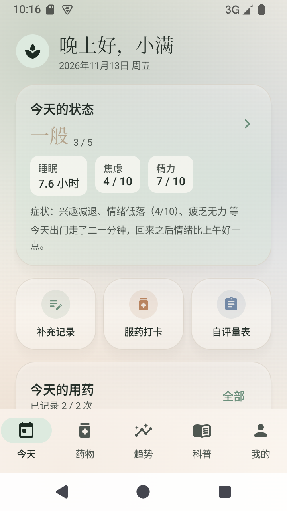 | 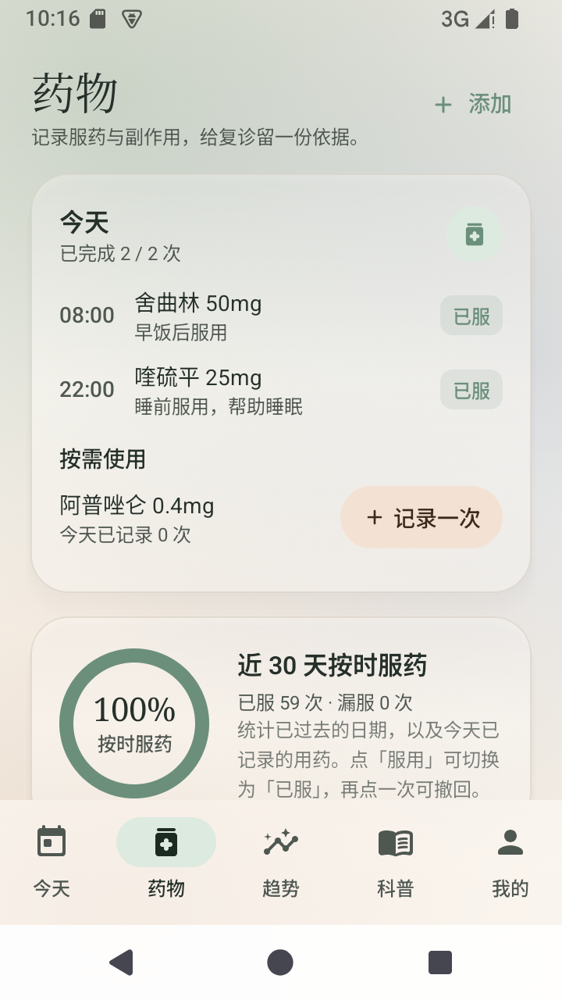 | 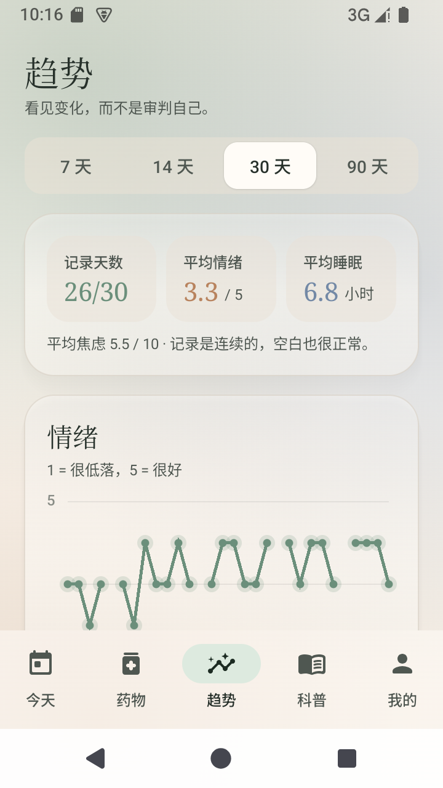 |

| 每日打卡 | 自评量表 | 日记 |
| --- | --- | --- |
| 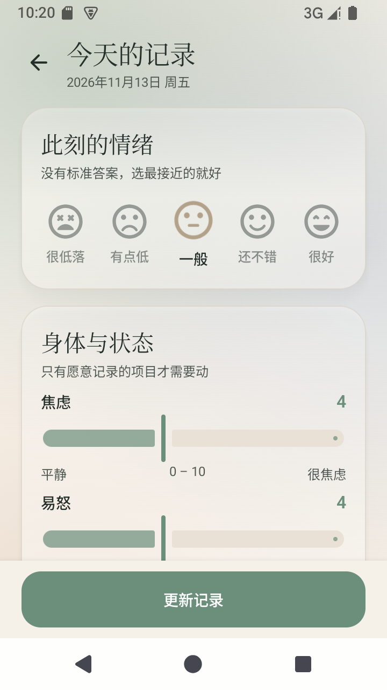 | 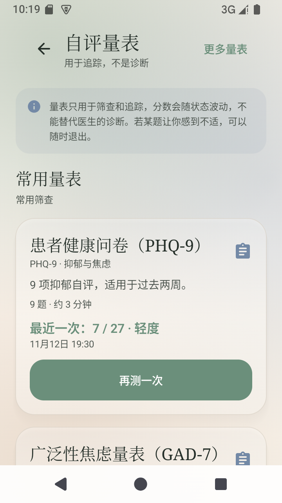 | 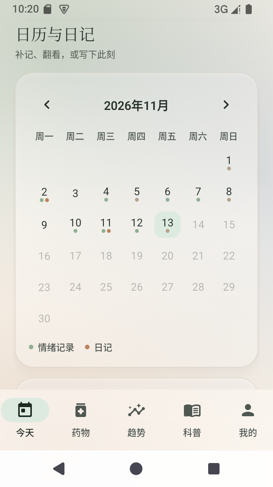 |

| 科普 | 科普详情 | 设置与主题色 |
| --- | --- | --- |
| 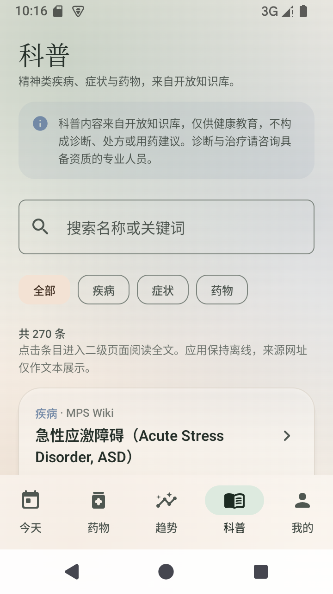 | 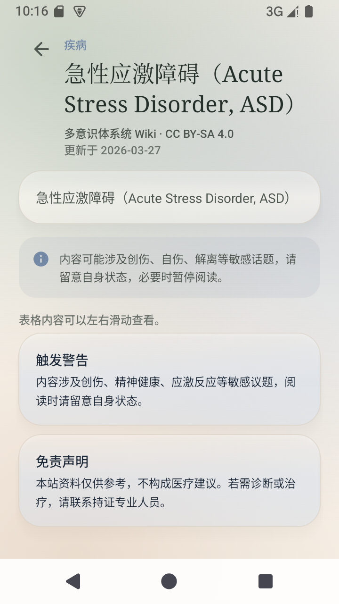 | 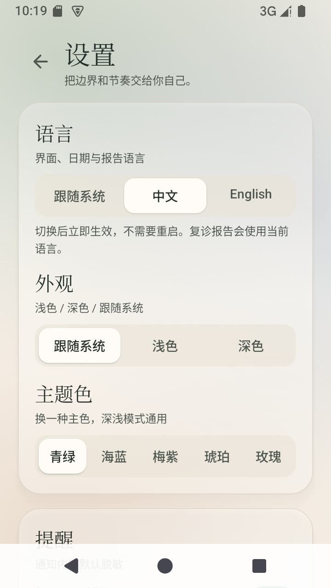 |

| 赞助与作者的话 | 紧急支持（地区） | 首页（深色） |
| --- | --- | --- |
| 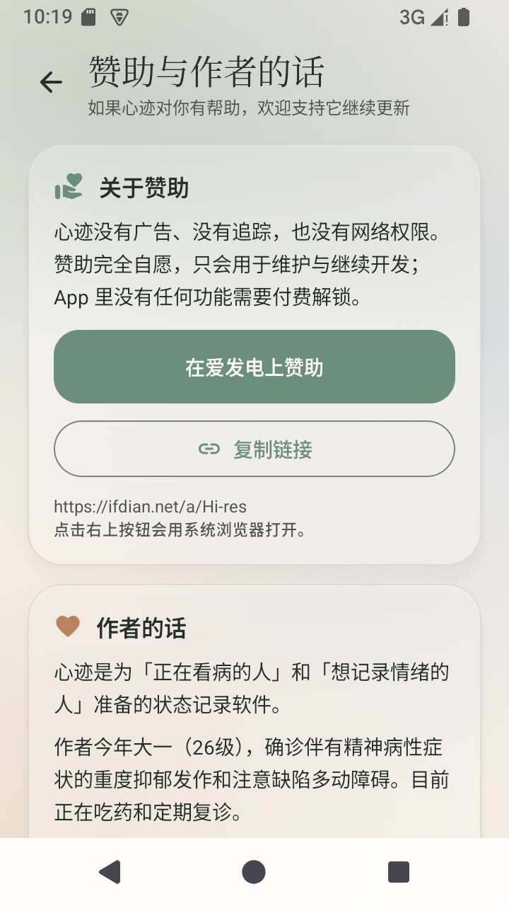 | 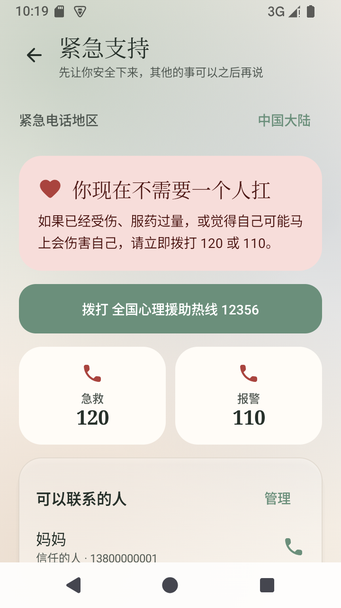 | 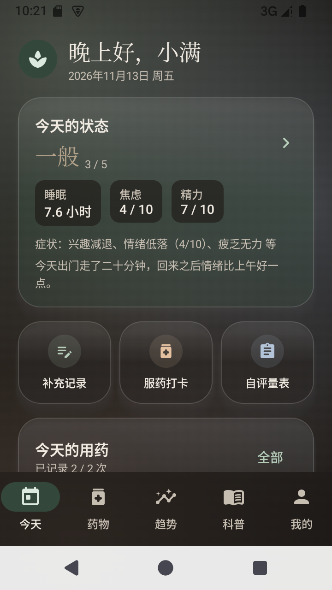 |

| 趋势（深色） | 复诊报告 PDF 第 1 页 | 复诊报告 PDF 第 2 页 |
| --- | --- | --- |
| 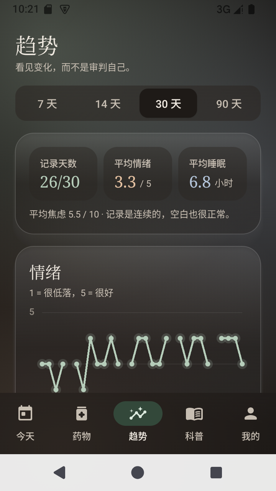 | 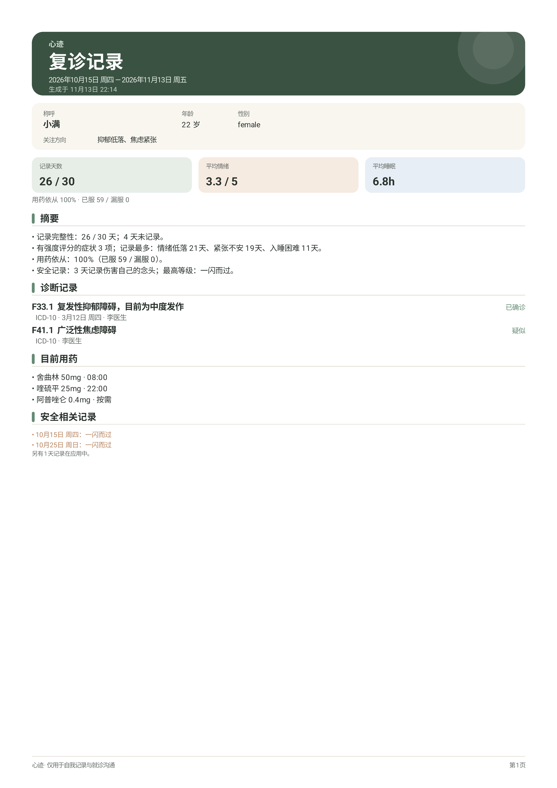 | 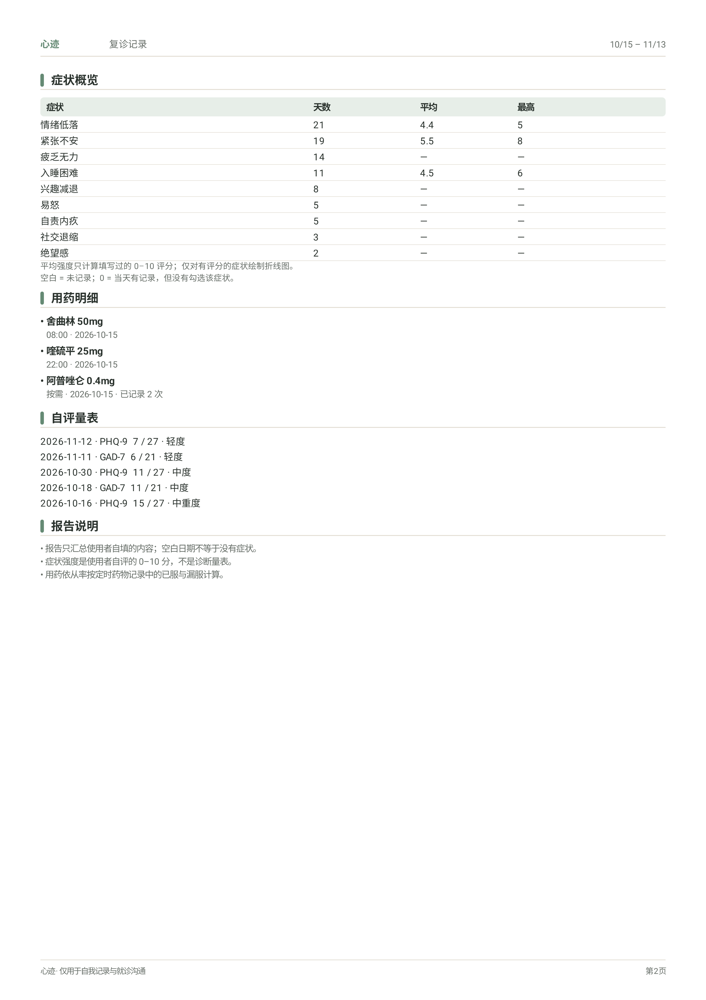 |

## 已实现（0.4.1 正式版）

- 首次引导：医疗免责声明、病种/症状选择、提醒设置、可选应用锁
- **5 个底部标签**：今天、药物、趋势、科普、我的；页面常驻组合，切换无闪烁且保留滚动位置
- 每日打卡：情绪、焦虑、易怒、精力、食欲、注意力、睡眠、症状、诱因、用药与副作用、自由备注
- 精神分裂症谱系：新增阳性症状（幻觉、妄想、思维/行为紊乱、紧张症等）与阴性症状（情感平淡、言语贫乏、意志减退、个人卫生下降等）；勾选任意症状后，都可拖动滑块记录 0–10 强度
- 伤害自己的念头分级记录，出现较高风险时提供温和的紧急支持入口
- **今天页内置日历与日记**：按月浏览、按天补记、当天概览、最近日记，不再需要单独的「记录」标签
- 自由日记：日期、标题、情绪、标签
- 药物管理：名称/剂量/单位/每日时间/起止日期/按需用药、每日服药打卡、近 30 天依从率
- 按需用药可在首页或药物页直接记录，带触觉反馈、Toast、今日次数与最近时间；最近一次可撤销，今日记录可逐条删除
- 定时药物只有一个「服用 / 已服」切换按钮，再点「已服」可撤销误点
- 本机提醒：每日记录提醒、按药物时间的用药提醒，支持脱敏通知与开机恢复
- **药物排序**：在服药物支持长按拖动排序，顺序持久化
- **服药补记**：药物页可补记过去任意一天的服药记录（标记已服 / 撤销 / 删除），依从率、趋势与 PDF 同步更新；删除药物后历史记录仍保留，在补记中显示为「已删除的药物」
- **药物预设**：添加药物时可从 281 条中英双语通用名中搜索选择（只写通用名、不区分剂型），药物名随界面语言切换
- **服药时间可添加多次**，不再限制 2 次
- **多套主题色**：青绿 / 海蓝 / 梅紫 / 琥珀 / 玫瑰，配合浅色、深色与跟随系统；毛玻璃卡片与极光渐变背景
- 自评量表：24 个自评/筛查量表，常用量表前置，更多量表按类别浏览
- **科普**：270 条离线内容，分为疾病（127 条）、症状（41 条）与药物（102 条）三类；疾病与症状来自多意识体系统 Wiki，药物来自维基百科；药物详情包含快速了解表格、类别说明、概述、同类药物与安全提醒；支持分类、搜索、独立二级阅读页，以及原生表格渲染与横向滚动
- **科普英文**：150 条疾病 / 症状条目全部具备英文正文与英文描述，全部 270 条内容均可在中英界面下阅读
- 趋势：7/14/30/90 天的情绪、焦虑、睡眠、症状频率、**症状强度折线图**与用药依从；症状强度可按阳性/阴性等症状切换
- 复诊报告：在本机生成 PDF，可保存或分享；同时支持 CSV 导出
- **症状强度滑块不再依赖病种**：勾选任意症状后都可以记录 0–10 强度；默认「未评分」，可拖动或清除
- **复诊 PDF 提供两种版式，由用户选择**：
  - **医生详细版（默认）**：摘要页、症状概览与用药/量表页，再加 2 列大图症状折线图；每页最多 6 张，适合打印和医生阅读
  - **一页摘要**：3 列紧凑症状图，通常 1 页，适合自己留存或快速分享
- 每张症状图都包含每日强度实线与平均强度虚线；应用内提供可缩放、可拖动的窗口预览
- 安全计划：警示信号、应对方式、留下的理由、环境安全、联系人、公共危机资源
- **紧急支持地区**：内置 18 个地区的急救、报警与心理援助热线，可随所在地切换并持久化
- **赞助与作者的话**：设置内可查看作者的话，并通过系统浏览器打开爱发电支持项目；首次设置包含作者的话页，第 5 次启动提供一次温和提示
- 加密备份：使用用户自设密码导出 `.mtrbackup`，可恢复
- 应用锁：4–6 位 PIN、可选指纹/面容、后台返回自动锁定
- 防截屏、通知脱敏、无账号、无广告、无统计 SDK
- **「我的」页集中展示资料、症状、诊断、安全计划与数据备份**；应用设置收进右上角齿轮
- 使用条款、隐私说明、提醒帮助与诊断信息页，方便自行排查问题
- 中英文界面切换（跟随系统 / 中文 / English），日期、通知、量表与 PDF 同步切换
- 诊断记录：ICD-10 / ICD-11 / DSM-5 常用条目搜索、自定义诊断、状态与确诊信息
- 应用内窗口化 PDF 预览（双指缩放、拖动、翻页），PDF 版式重新设计
- 包括 PHQ-9、GAD-7、PCL-5、MDQ、OCI-R、ISI、DASS-21 等；结果支持分级、分量表、来源与使用边界说明

## 隐私设计

- **不申请 INTERNET 权限**：应用本身无法联网，也没有账号或云同步。
- **SQLCipher 全库加密**：数据库口令随机生成，由 Android Keystore 中的不可导出密钥包裹。
- **PIN 只存哈希**：使用 PBKDF2-HMAC-SHA256；PIN 只是界面门禁，数据安全依赖加密数据库。
- **禁止系统云备份**：`allowBackup=false`，并从设备迁移中排除数据。
- **导出由你控制**：PDF、CSV、加密备份都通过系统文件选择器保存到你指定的位置。
- **删除即销毁**：删除全部数据会同时销毁数据库密钥。

## 构建

环境与版本：

- JDK 17
- Android SDK Platform 35，Build Tools 35.0.0
- Gradle 8.9（wrapper）
- AGP 8.7.3
- Kotlin 2.0.21
- minSdk 26 / targetSdk 35

```bash
./gradlew :app:assembleDebug
./gradlew :app:assembleRelease
```

产物：

- `app/build/outputs/apk/debug/app-debug.apk`
- `app/build/outputs/apk/release/app-release.apk`

release 签名读取根目录的 `keystore.properties`（已 gitignore）。没有该文件时仍可构建，但 release APK 不会签名。自己发布时请生成自己的密钥：

```bash
keytool -genkeypair -v -keystore keystore/mindtrace-release.jks \
  -alias mindtrace -keyalg RSA -keysize 2048 -validity 10000
```

```properties
storeFile=keystore/mindtrace-release.jks
storePassword=...
keyAlias=mindtrace
keyPassword=...
```

构建环境：

- 确保 `JAVA_HOME` 指向 JDK 17。如需指定其他 JDK，可在用户级 `~/.gradle/gradle.properties` 中设置 `org.gradle.java.home`，不要写进项目配置。
- 在 `local.properties` 中设置 `sdk.dir`（已 gitignore）。

## 发布产物

APK、示例 PDF、测试数据集与 SHA-256 见 [GitHub Releases](https://github.com/shanhangchi501-jpg/MindTrace/releases/latest)，不纳入 Git 历史（本地 `dist/` 已 gitignore）。

最新版本：[v0.4.1](https://github.com/shanhangchi501-jpg/MindTrace/releases/tag/v0.4.1)

0.4.1 Release APK SHA-256：`b07bc7530262af166d1b7f5df165f077f10a9de1754f9bfd2e3882f539e41170`

### 宣传 / 演示素材

- 演示数据集：`MindTrace-Demo-Dataset.mtbackup`（密码 `mindtrace-demo`），导入后得到 30 天打卡、3 种药物、62 条服药记录、5 份量表、4 篇日记、安全计划与 2 条诊断
- 使用 0.4.1 正式版安装后，在「我的 → 设置 → 数据与报告 → 从备份恢复」选择该文件即可
- 截图与 PDF 示例见 [docs/screenshots](docs/screenshots)

## 目录

```text
app/src/main/java/com/mindtrace/app/
├── data/       Room + SQLCipher、仓库、设置、症状/量表目录、备份
├── report/     复诊数据汇总与 PDF 生成
├── ui/         Compose 页面、主题、组件、ViewModel
└── work/       提醒、通知与开机恢复
```

## 已知限制

- 提供中文与英文界面；其他语言尚未覆盖。
- 没有云同步、多设备共享、家属端或可穿戴设备接入。
- 不提供 AI 分析、诊断、用药建议或心理治疗内容。
- PHQ-9 / GAD-7 仅用于筛查与追踪，分数不能用于自我诊断。
- 数据库 schema 版本为 3，已提供 1→2、2→3 迁移。
- 危机热线为内置公共资源，接听时间与可用性以当地为准；应用内可在紧急支持页切换地区并自行添加联系人。

## 医疗边界

心迹不是医疗器械。它不提供诊断、处方或治疗建议，不能替代医生或心理咨询师。

如果你正处于危险中，请立即联系 **120 / 110**，或拨打全国心理援助热线 **12356**。如果你已经伤害了自己或服用了过量药物，请立即前往最近的急诊。

## 测试

当前版本为 `0.4.1`，为正式签名版本。测试清单见 [TESTING.md](TESTING.md)，安装与使用说明见 [USER_GUIDE.md](USER_GUIDE.md)。

提醒功能声明了 `USE_EXACT_ALARM`（Android 13+ 自动授予），以保证每日记录和用药提醒准时触发。如果未来上架 Google Play，需要重新评估该权限的政策适用性；侧载版本不受此限制。

## 文档

- [USER_GUIDE.md](USER_GUIDE.md)：安装、使用、备份、提醒排查与常见问题
- [PRIVACY.md](PRIVACY.md)：权限、数据范围与隐私说明
- [TESTING.md](TESTING.md)：功能测试清单
- [CHANGELOG.md](CHANGELOG.md)：版本变更
- [RELEASE_NOTES.md](RELEASE_NOTES.md)：0.4.1 发布说明（中英）

## License

MIT，见 [LICENSE](LICENSE)。第三方组件与量表来源见 [NOTICE.md](NOTICE.md)。
